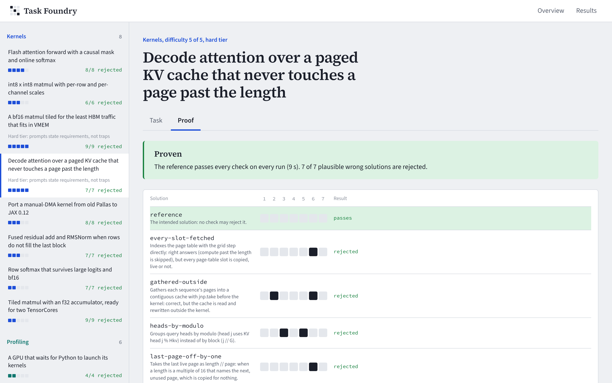
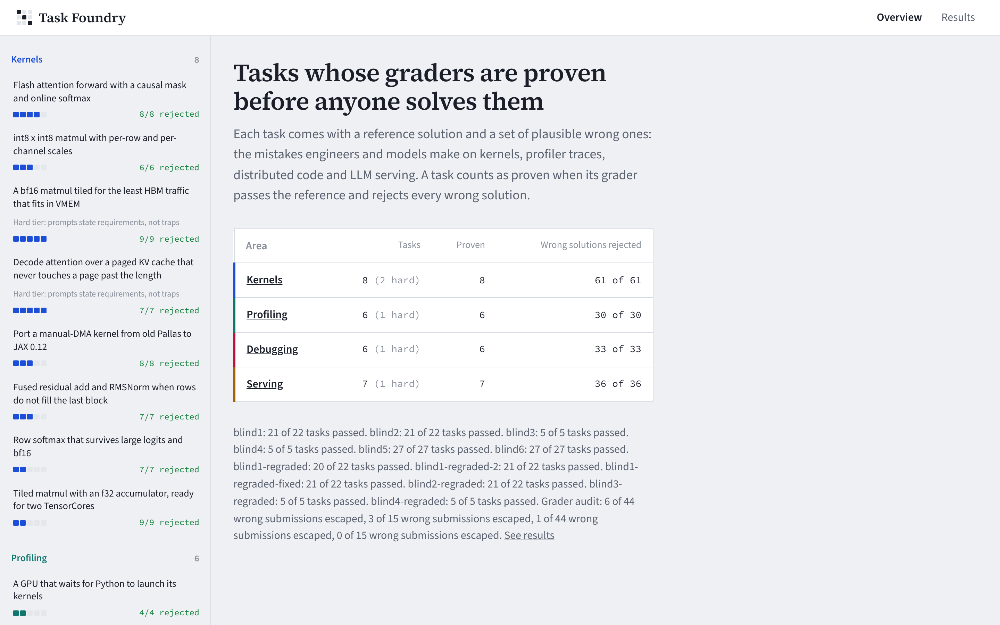
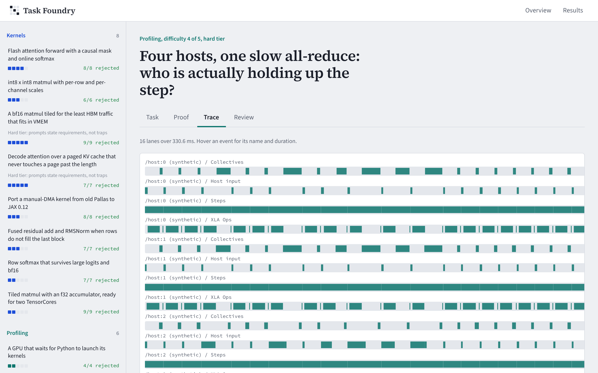
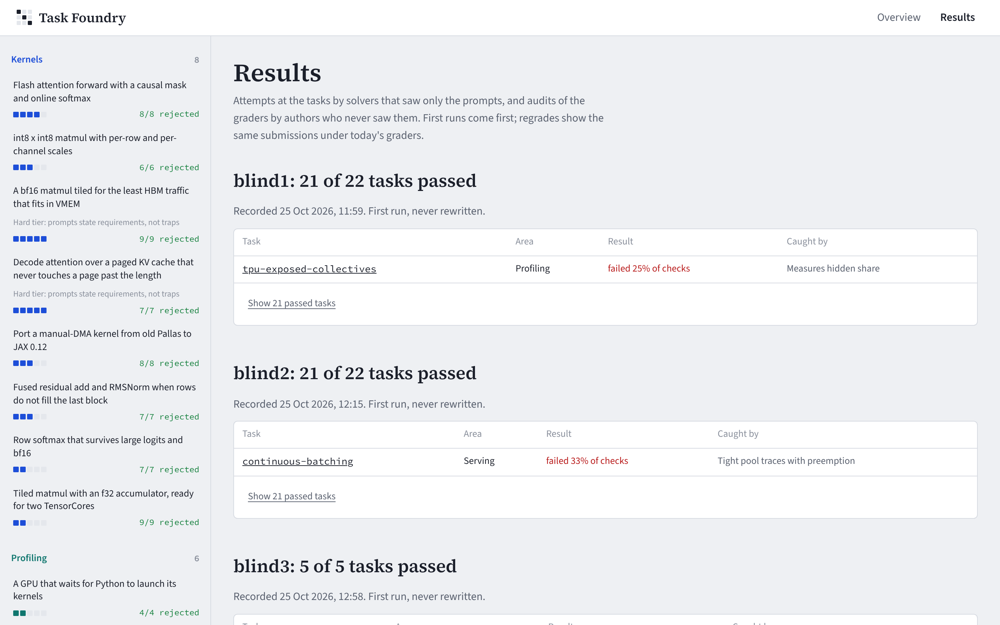

# mlsys-task-foundry

Tasks for training and evaluating models on ML-systems work (Pallas TPU kernels, profiler traces,
distributed JAX and LLM serving), each with a grader that is **proven before anyone solves the
task**: it passes a reference solution and rejects every one of a set of plausible wrong solutions,
the mistakes engineers and models actually make. Then the tasks are solved blind, and the graders
attacked blind, and every first run is recorded and never rewritten.



**What the blind runs found** (details below): the graders hold up. Blind auditors got 9 deliberately
wrong submissions past them, out of 59, and all eight real gaps are now closed and covered by
mutants. The ninth was an ambiguous prompt, now fixed. The tasks are not hard. All three Claude
model sizes solved nearly all of them, the smallest included, and so did the model that wrote them
without running a line of code. That is the honest limit of tasks a model writes for itself, and it
is why difficulty has to come from people who know where models break.

## Why

Writing a hard task is the easy half. The hard half is a grader that cannot be fooled, and a reader
cannot tell from a grader's code which mistakes it would catch. Recent benchmark work shows how this
goes wrong: kernel graders that test one input distribution let shape-matched and hard-coded
solutions pass ([KernelBench-Verified](https://www.alphaxiv.org/abs/2607.16241)), and on JAX the
largest share of agent failures is calling APIs that no longer exist rather than getting the
algorithm wrong ([JAXBench](https://arxiv.org/pdf/2607.20466)). This repository treats a task's
wrong answers as part of the task, and measures both the grader and the task.

## What is in it

27 tasks in four areas, all graded on CPU (see [what is simulated](#honest-limits)). Five form a
**hard tier**: their prompts state requirements, not the traps.

| Area | Core tasks | Hard tier |
|---|---|---|
| Kernels (Pallas TPU, JAX 0.12) | tiled matmul with an f32 VMEM accumulator and dimension semantics for two TensorCores; row softmax that survives large logits and bf16; causal flash attention with online softmax; fused residual + RMSNorm with a ragged last block; int8 × int8 matmul with per-row and per-channel scales; porting a manual-DMA kernel off removed Pallas APIs | a bf16 matmul tiled for the least HBM traffic under 16 MiB of VMEM (traffic and VMEM read from the solution's own BlockSpecs); paged decode attention with scalar-prefetched page tables, GQA and NaN in every slot it does not own, copying each live page once and nothing else |
| Profiling (traces) | a step that recompiles every batch (real `jax.profiler` trace, code fix and answer); a host-bound input pipeline (real trace); exposed FSDP collectives on TPU (synthetic xprof-style); a launch-bound GPU optimizer (synthetic Kineto-style); roofline classification of LLM ops on an H100 | four hosts and one long all-reduce: find the host everybody waits for, its cause and the step time without it (synthetic) |
| Debugging (8 simulated devices) | replicas that drift after someone turned `check_vma` off; vocabulary-parallel cross-entropy; NaN gradients from an all-padding sequence; the same dropout mask on every shard; gradient accumulation that does not match the big batch | causal ring attention with `shard_map` and `ppermute` only, gradients included |
| Serving | paged KV allocator with fork and copy-on-write; continuous batching with chunked prefill and preemption; prefix caching by chained block hashes; KV capacity for an 8B GQA model on an H100; when TPU v6e decode stops being memory-bound; speculative-decoding speedup | KV capacity for a model whose sliding-window layers straddle block boundaries, with a prefix shared only where it is still held |

Each task folder holds `task.yaml`, `prompt.md` (what the solver sees), sometimes `starter.py` and
`assets/`, `grader.py`, `reference/`, `mutants/<name>/` (each naming the failure mode it represents)
and, for written answers, `rubric.yaml` with a pass and a fail example per criterion.

## Results

### The forge: every grader proven

`foundry forge` grades each reference twice and every mutant once
([reports/FORGE.md](reports/FORGE.md)):

- **27 of 27 tasks proven; 160 of 160 plausible wrong solutions rejected** by 151 checks
  (15 checks no mutant fails, listed per task as candidates for new mutants); 11 minutes on two CPU
  cores.
- Numeric checks run on five input distributions (uniform, ×100, ×0.01, negated, normal).
- Every kernel is also **lowered for a real TPU** (Pallas to Mosaic, against an abstract TPU v6e,
  no TPU needed). The interpreter accepts blocks a chip rejects. Five mutants pass in the interpreter
  and are caught only by lowering.
- Solutions and starters are scanned for APIs removed or deprecated by JAX 0.12.0.1
  (`pltpu.TPUCompilerParams`, `pl.dot`, `jax.lax.pvary`, `jax.experimental.shard_map`, …). A test
  confirms every name listed as removed in `config/api_deprecations.yaml` is really gone from the
  installed JAX.

The forge caught its author several times. The fixes are in the history:

- **A reference that was 8× wrong.** Under JAX 0.12's `shard_map` with `check_vma` on, autodiff
  already sums the gradient of a replicated parameter across the data axis. Code written for older
  JAX then adds a `pmean`, which makes the update 8× too large on 8 devices. The task's reference
  had done exactly that, and the forge's comparison with a single-device run caught it. That mistake
  is now a mutant, and it is the point of the task.
- **Seven mutants that were correct solutions.** The forge reported them as surviving:
  - two "NaN from padding" mutants and a first ring-attention one, where a `where` on the scores
    stopped the NaN before any parameter;
  - a scheduler mutant that its own invariants made equivalent;
  - three whose change could not alter the result.

  Each was deleted or rewritten into the mistake it was meant to represent. None was "killed" by
  making a grader reject correct code.
- **An ill-conditioned check, and rubric examples that disagreed with the trace.** Both were fixed.
  The rubrics now quote the trace.

### Blind attempts

Solvers saw only the solver's files (prompt, starter, assets) in a separate folder
([reports/attempts/SOLVERS.md](reports/attempts/SOLVERS.md)). A scan of their transcripts found no
access to the graders, references or other sets.

| Set | Tasks | Solver | Ran code | First run |
|---|---|---|---|---|
| blind1 | 22 core | the author's model | yes | 21 of 22 |
| blind2 | 22 core | the author's model | **no** | 21 of 22 |
| blind3 | 5 hard | the author's model | yes | 5 of 5 |
| blind4 | 5 hard | the author's model | **no** | 5 of 5 |
| blind5 | 27 | Claude Haiku | yes | 27 of 27 |
| blind6 | 27 | Claude Sonnet | yes | 27 of 27 |

The two blind1 and blind2 failures taught something:

- **blind1** failed one task because the prompt was ambiguous. "Collective time" could mean summed
  or wall-clock. The prompt now says which.
- **blind2**, written without running code, failed one. Its continuous-batching scheduler left a
  waiting request out of a step where the prompt's first-come-first-served rule admits 4 of its
  tokens. The same model passed that task when it could test its code.

Neither is a gap in model knowledge worth training on. The conclusion is plain: these tasks are verified
training and evaluation items, not adversarial ones. A model writing tasks for itself tends to
write what it already knows. The foundry is how you find that out in an afternoon rather than after
a data delivery.

### Blind grader audits

Auditors who never saw the graders wrote deliberately wrong submissions: subtle numeric errors,
structural dodges, gradients that break while the forward pass looks right.

| Audit | Wrong submissions | Escaped on the first run | After the fixes |
|---|---|---|---|
| audit1 (core) | 44 | 6: five real gaps, one ambiguous prompt | 0 real escapes ([audit1.STUDIED.md](reports/audits/audit1.STUDIED.md)) |
| audit2 (hard) | 15 | 3, all real gaps | 0 of 15 ([audit2.STUDIED.md](reports/audits/audit2.STUDIED.md)) |

The escapes were the most useful result of the project:

- flash attention never tested with `bq ≠ bk`;
- a "manual DMA" port that let the pipeline do the copy;
- token ids above 65,535 hashed in 16 bits;
- truncated sequences hidden by a loss tolerance;
- a ragged tail computed outside the kernel;
- bf16 accumulation inside a 1% tolerance;
- a tiling search that never put N outermost;
- an all-gather written as n − 1 `ppermute`s.

Each is now a check plus a mutant that only that check catches. The new checks were run against
every blind solution, to confirm they reject the mistakes and not correct code. The stricter TPU
lowering check itself had a bug, found the same way: it rejected a valid kernel that asks which chip
it runs on. That is documented in [blind1.STUDIED.md](reports/attempts/blind1.STUDIED.md).

## How grading works

- **Checks** are plain functions in each `grader.py`, registered with
  `@check(targets=[failure modes], weight=…)`. They compute expected values independently: a float64
  NumPy reference for kernels, the same trace-reading functions the solver would use for profiling
  answers, an independent simulator that checks every scheduling decision for serving code.
- **The runner** grades in a child process with a nonce, a memory limit, a timeout, a temporary HOME
  and a stripped environment. A submission that prints a fake result line, patches `np.allclose` or
  the grader's comparison helpers, or hangs, gets a void or failed run (`tests/test_runner.py`).
- **Kernels** run in Pallas' TPU interpreter (`pltpu.InterpretParams`), which simulates VMEM, DMAs
  and semaphores, fills uninitialised memory with NaN and runs parallel grid points in random order
  on two simulated cores, so a reduction axis marked `parallel` fails instead of passing by luck.
  They are also lowered to Mosaic for a TPU v6e, which enforces the tiling rules the interpreter
  ignores. Structural requirements (where data lives, what runs outside the kernel, how many blocks
  are copied, how long any per-device axis gets) are read from the traced program itself.
- **Written answers** are graded twice: numbers and labels by checks, the explanation by people
  against the rubric in the console, with Cohen's kappa between two reviewers.

## The console

`foundry serve` serves a review console (React, TypeScript, Framer Motion) and its API:

- **Overview** and a task rail by area, with each task's proof status;
- **Task**: the prompt, starter and the failure modes it targets;
- **Proof**: the kill matrix, which check rejects which wrong solution, and anything idle;
- **Trace**: the task's profiler trace as lanes, with the longest totals;
- **Review**: the rubric with pass and fail examples, saved reviews and reviewer agreement;
- **Results**: blind attempts and audits, first runs before regrades, failures first and the rest behind a toggle.

Every screen has loading, error-with-retry and empty states.

| Overview | Trace (multi-host straggler) | Results |
|---|---|---|
|  |  |  |

## Run it

```bash
pip install -e ".[dev]"          # Python 3.11+, JAX 0.12.0.1 on CPU
foundry list                     # the tasks
foundry forge                    # prove every grader (about 11 minutes on 2 cores)
foundry grade tiled-matmul path/to/submission/
foundry attempt <label>          # grade attempts/<label>/<task>/, recorded once
foundry audit <label>            # grade audits/<label>/<task>/<variant>/, report escapes
cd web && npm ci && npm run build && cd .. && foundry serve
```

or `docker compose up` and open http://localhost:8000.

Tests: `pytest -q -m "not slow"` (seconds), `pytest -q -m slow` (forges every task), and
`cd web && npm test`. CI runs lint, mypy, both test sets, the console's typecheck, lint, tests and
build, and builds the image and checks it serves the API and the console.

## Honest limits

- **No accelerator was used.** Kernels are checked for correctness and memory-space discipline in the
  TPU interpreter, not for speed. Nothing here claims a kernel is fast.
- **Three of the five traces are synthetic.** The TPU collectives, GPU launch and multi-host
  straggler traces are generated by `scripts/make_assets.py` in the xprof and Kineto formats,
  because none of these behaviours can be recorded on one CPU. The recompilation and host-bound
  traces are real `jax.profiler` recordings.
- **Traffic is counted by the pipeline's stated rule, not measured.** The HBM-traffic and paged
  attention graders evaluate the solution's own index maps under the documented Pallas TPU rule (a
  copy whenever the block index changes). They do not observe a chip.
- **Hardware numbers** (H100, TPU v5e and v6e) come from vendor pages cited in
  `config/hardware.yaml`; the serving tasks reason with them, they were not measured.
- **The blind solvers and auditors were models** working only from the solver's files, all Claude.
  Solvers from other model families, and human experts, would give a fairer difficulty estimate.
  The tasks did not prove hard for any Claude size, and the rubrics have not yet been through two
  independent human reviewers.
- **The runner isolates against a solver gaming the grader, not against malicious code.** Run
  untrusted submissions in a container or VM as well.

## Layout

```
config/          settings, hardware specs with sources, failure modes, API deprecations
src/foundry/     task loading, checks, runner, forge, API scan, traces, roofline, rubric, API
tasks/<area>/    the 27 tasks (task.yaml tier: hard marks the hard tier)
scripts/         asset generation, mutant authoring
reports/         forge, attempt and audit reports (first runs are never rewritten)
attempts/ audits/ blind submissions
web/             the review console
docs/adr/        decisions: proven graders, CPU interpreters, isolation and first runs
```

MIT licence.
